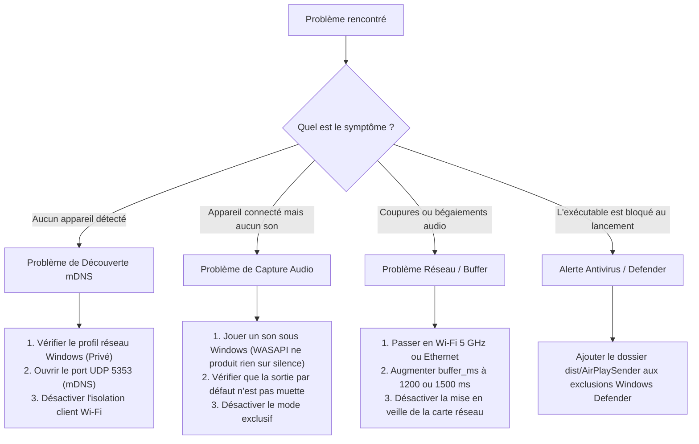

# Guide de Dépannage et Arbre de Décision (Troubleshooting)

Ce document fournit les solutions détaillées aux incidents courants rencontrés lors de l'utilisation d'AirPlay Sender sous Windows 11.

---

## 1. Arbre de Décision Rapide



---

## 2. Découverte Réseau (mDNS / Zeroconf)

### Symptôme
La commande `python -m airplay_sender scan` ne trouve aucune enceinte ou affiche `Aucun appareil découvert`.

### Causes probables et solutions

1. **Profil réseau Windows défini sur "Public"** :
   - Par défaut, Windows bloque tout le trafic multicast entrant (mDNS UDP 5353) lorsque le réseau est classé "Public".
   - **Vérification** : Ouvrez PowerShell et tapez :
     ```powershell
     Get-NetConnectionProfile
     ```
   - **Correction** : Si `NetworkCategory` est `Public`, passez-le en `Private` :
     ```powershell
     Set-NetConnectionProfile -InterfaceAlias "Wi-Fi" -NetworkCategory Private
     ```

2. **Isolation Client (AP Isolation) sur le routeur Wi-Fi** :
   - Certaines box Internet ou points d'accès Wi-Fi invité empêchent les équipements sans fil de communiquer entre eux.
   - **Correction** : Accédez à la console de gestion de votre box/routeur (ex: `192.168.1.1`) et assurez-vous que l'option **Isolation AP / Isolation des clients** est désactivée sur votre réseau Wi-Fi.

3. **Multiples interfaces réseau virtuelles (VPN, WSL, Hyper-V, VirtualBox)** :
   - Les requêtes mDNS peuvent partir sur une interface virtuelle au lieu de la véritable carte Wi-Fi ou Ethernet.
   - **Correction** : Désactivez temporairement les adaptateurs virtuels ou précisez l'adresse IP locale dans la configuration.

4. **Pare-feu Windows bloquant le port UDP 5353** :
   - Ouvrez le port mDNS entrant dans le pare-feu :
     ```powershell
     New-NetFirewallRule -DisplayName "AirPlay Sender mDNS" -Direction Inbound -Protocol UDP -LocalPort 5353 -Action Allow
     ```

---

## 3. Capture Audio (WASAPI Loopback)

### Symptôme
L'état affiche `STREAMING`, mais aucun son ne sort de l'enceinte Devialet, ou le son se coupe dès qu'on met en pause.

### Causes probables et solutions

1. **Comportement normal de WASAPI Loopback en l'absence de signal** :
   - **Rappel architectural** : Le sous-système WASAPI Loopback de Windows ne génère **aucun événement / callback audio** lorsqu'aucune application ne joue de son.
   - AirPlay Sender injecte automatiquement un flux de zéros (silence) pour maintenir la connexion RTSP active. Dès que vous lancez une vidéo, un titre Spotify ou un son système, le son est répercuté immédiatement sur l'enceinte.

2. **Mode exclusif actif sur la carte son** :
   - Si une application (ex: DAW, Foobar2000 en mode ASIO/WASAPI Exclusive, lecteur vidéo configuré en bitstream) a réquisitionné le périphérique audio en mode exclusif, le loopback peut être bloqué.
   - **Correction** :
     1. Tapez `mmsys.cpl` dans Windows (Exécuter).
     2. Clic droit sur votre périphérique de sortie par défaut > **Propriétés**.
     3. Onglet **Statistiques avancées** > décochez *"Autoriser les applications à prendre le contrôle exclusif de ce périphérique"*.

3. **Changement inattendu de périphérique par défaut** :
   - Si vous branchez un casque USB ou Bluetooth, Windows bascule la sortie par défaut.
   - AirPlay Sender intègre un observateur automatique (`AudioDeviceWatcher`) qui détecte la bascule en 2 secondes et réinitialise la capture sur la nouvelle sortie sans couper le flux AirPlay.

---

## 4. Coupures, Décalages et Jitter Réseau

### Symptôme
Le son crépite, saute ou se reconnecte régulièrement.

### Causes probables et solutions

1. **Perturbations sur la bande Wi-Fi 2,4 GHz** :
   - Le protocole RAOP transmet du son PCM 16-bit 44.1 kHz non compressé à ~1,4 Mbit/s en UDP régulier. Les collisions sur la bande 2,4 GHz (micro-ondes, Bluetooth, réseaux voisins) provoquent des pertes de paquets UDP.
   - **Correction** : Connectez votre PC et votre enceinte sur le réseau Wi-Fi **5 GHz**, ou idéalement reliez le PC ou l'enceinte par câble **Ethernet**.

2. **Économie d'énergie agressive de la carte Wi-Fi** :
   - Windows peut mettre la carte réseau en état de basse consommation lors de l'inactivité de l'utilisateur.
   - **Correction** : Dans le *Gestionnaire de périphériques* > *Cartes réseau* > Clic droit sur votre carte Wi-Fi > *Propriétés* > *Gestion de l'alimentation* > décochez *"Autoriser l'ordinateur à éteindre ce périphérique pour économiser l'énergie"*.

3. **Taille du tampon audio trop faible** :
   - Le tampon par défaut est fixé à 800 ms. Si votre réseau subit des micro-variations de latence, augmentez la taille du tampon :
     - Dans `%APPDATA%\airplay-sender\config.json`, passez `"buffer_ms": 1200` ou `1500`.

---

## 5. Faux Positifs Antivirus (Windows Defender)

### Symptôme
Windows Defender affiche une alerte *"SmartScreen a empêché le démarrage d'une application non reconnue"* ou supprime l'exécutable `dist\AirPlaySender\AirPlaySender.exe`.

### Explication & Solution
- C'est un phénomène très fréquent pour tous les exécutables compilés avec PyInstaller qui ne possèdent pas de certificat de signature de code payant.
- Le code source est entièrement auditable et ne contient aucun composant malveillant.
- **Pour autoriser l'exécution** :
  1. Cliquez sur *"Informations complémentaires"* dans la bannière bleue SmartScreen, puis sur *"Exécuter quand même"*.
  2. Pour éviter les alertes répétitives lors des recompilations, ajoutez le dossier de build aux exclusions de Windows Defender :
     ```powershell
     # Exécuter dans PowerShell en tant qu'administrateur si souhaité :
     Add-MpPreference -ExclusionPath "C:\chemin\vers\AirPlayWindows\dist"
     ```

---

## 6. Outil de Diagnostic Automatique

Si un problème persiste :
1. Lancez la commande suivante :
   ```powershell
   python -m airplay_sender diag -o rapport_diagnostic.txt
   ```
2. Ou faites un clic droit sur l'icône dans la barre des tâches > **Copier le rapport de diagnostic**.
3. Consultez les sections du rapport pour vérifier l'adresse IP active, le loopback par défaut et les dernières traces d'erreur.
